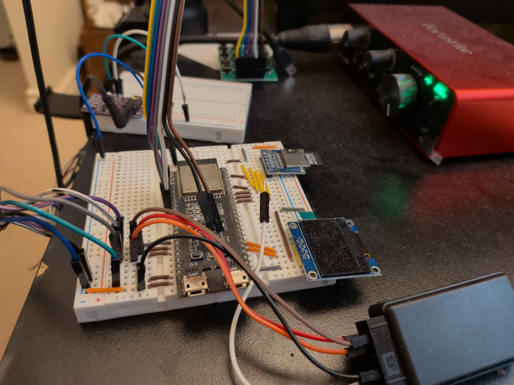
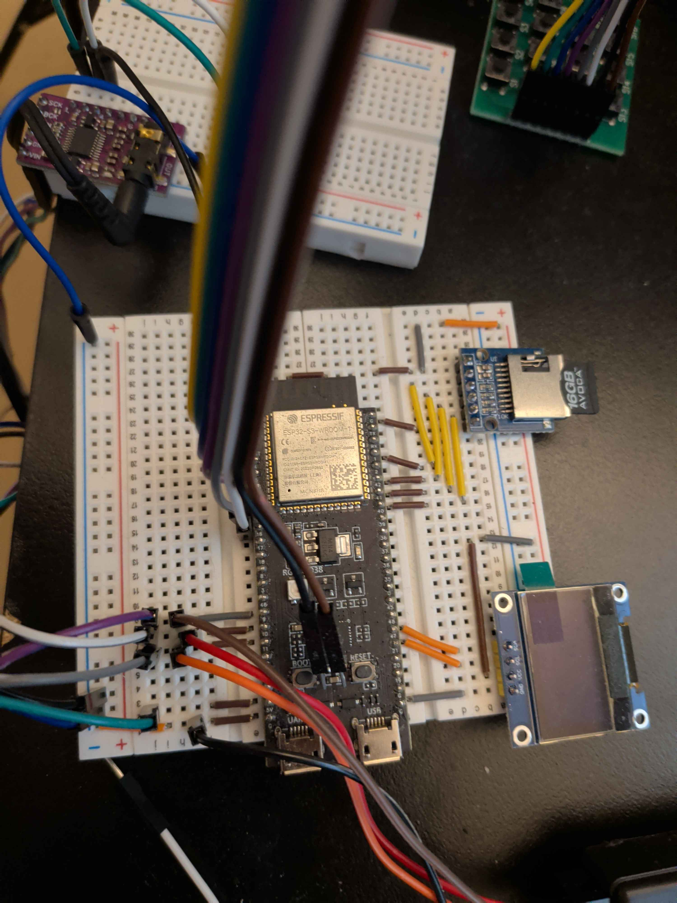
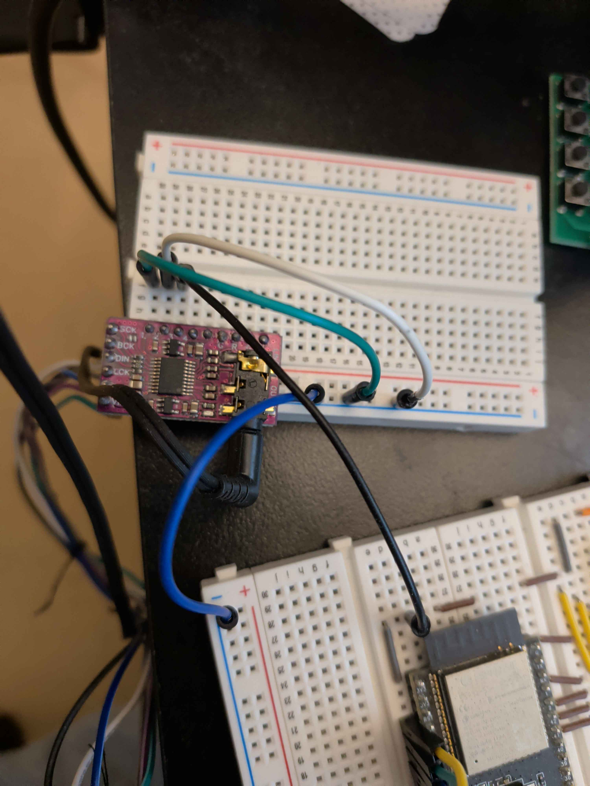
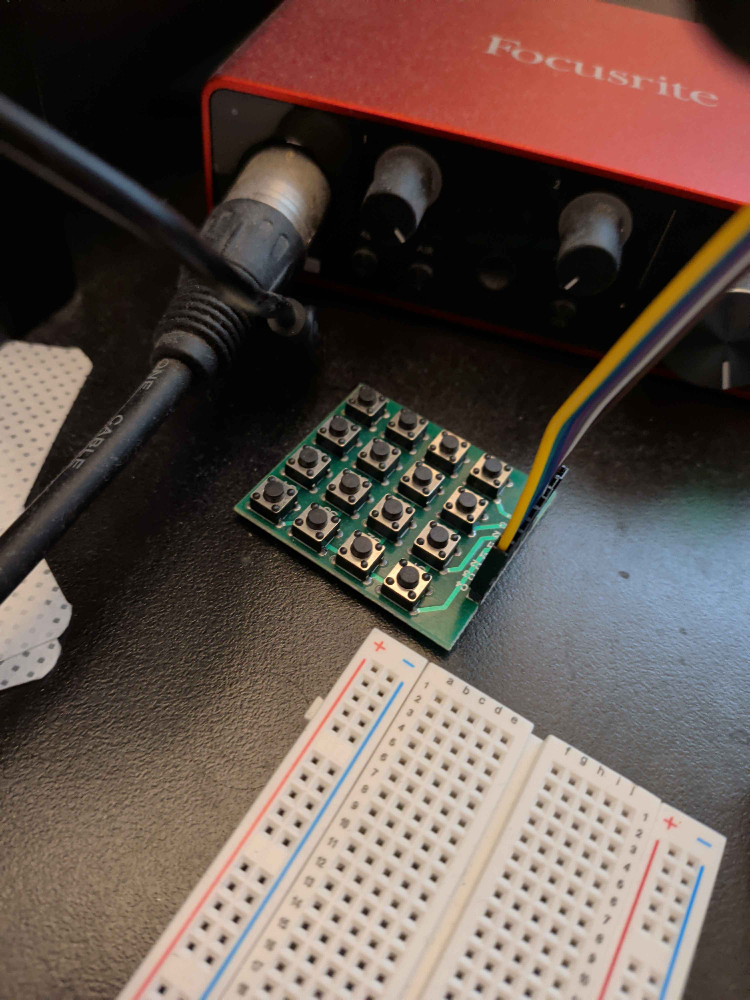
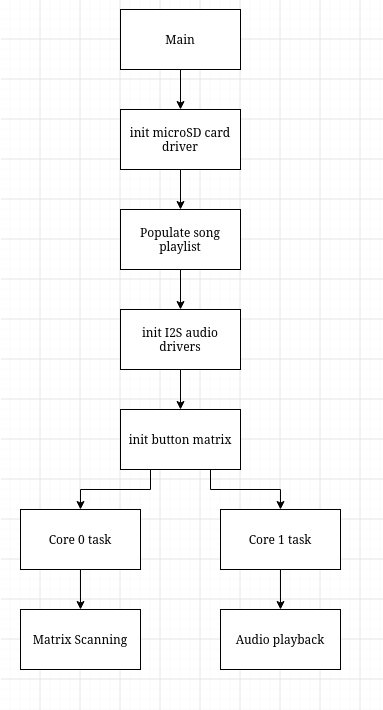
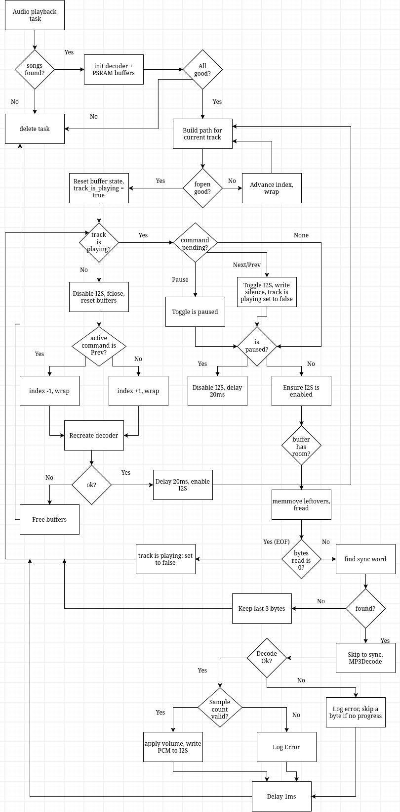
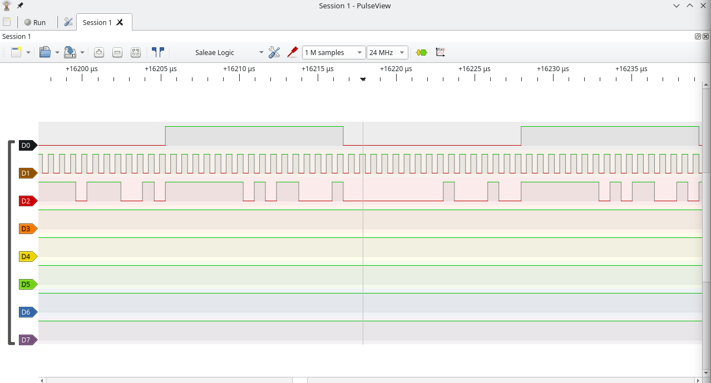

# ESP32-S3 Embedded Audio Player

A work-in-progress MP3 player built on the ESP32-S3. It reads MP3 files from a microSD card, decodes them using the Helix MP3 decoder, and outputs audio through a PCM5102 DAC over I2S. A physical button matrix handles volume, playback, and track navigation.

**Status: work in progress.** See [Known issues](#known-issues).

**Video**

**Photo 1**

**Photo 2**

**Photo 3**

**Photo 4**

## Features

- Plays `.mp3` files from the root of a FAT-formatted microSD card (SPI mode)
- Software decoding with Helix (`mp3dec.h`)
- I2S output to a PCM5102 DAC (44.1 kHz, 16-bit stereo)
- Button controls: volume up/down, previous, next, pause/resume
- Two FreeRTOS tasks: input scanning on core 0, audio on core 1
- MP3 input and PCM output buffers allocated in PSRAM

## Hardware

- ESP32-S3 board with PSRAM
- microSD card module (SPI)
- PCM5102 I2S DAC module
- Button matrix (wired as 4x4, 2 rows x 4 columns used in code)
- SSD1306-style OLED (wired, not yet used in code)

### Pin connections

**microSD**

| SD   | ESP32-S3 |
|------|----------|
| GND  | GND      |
| 3V3  | 3V3      |
| MISO | GPIO 40  |
| MOSI | GPIO 42  |
| CS   | GPIO 1   |
| CLK  | GPIO 41  |

**PCM5102 DAC**

| PCM5102 | ESP32-S3 |
|---------|----------|
| VIN     | 5V       |
| GND     | GND      |
| LRCK    | GPIO 9   |
| BCK     | GPIO 10  |
| DIN     | GPIO 11  |
| SCK     | GND      |
| XSMT    | 3V3      |
| FMT     | GND      |
| FLT     | GND      |
| DEMP    | GND      |

**Button matrix**

| Matrix | ESP32-S3 |
|--------|----------|
| R1     | GPIO 15  |
| R2     | GPIO 16  |
| C1     | GPIO 7   |
| C2     | GPIO 6   |
| C3     | GPIO 5   |
| C4     | GPIO 4   |

**OLED (wired, no code yet)**

| OLED | ESP32-S3 |
|------|----------|
| GND  | GND      |
| VCC  | 3V3      |
| SDA  | GPIO 21  |
| SCL  | GPIO 47  |

### Button map

| Key | Action      |
|-----|-------------|
| S1  | Volume up   |
| S2  | Previous    |
| S3  | Pause/resume|
| S4  | Next        |
| S5  | Volume down |

S6-S8 are unassigned.

## How it works

1. `app_main` mounts the SD card, scans its root directory for MP3 files (up to 120), initializes I2S, and sets up the button matrix.
2. `matrix_scanner_task` runs on core 0. It scans the button matrix and handles button presses. Volume changes are applied directly, while track skips and pause/resume are passed to the audio task through `pending_system_command`.
3. `mp3_player` runs on core 1. It reads the current track, decodes MP3 frames, applies volume scaling, and sends PCM audio to I2S.
4. When a track finishes or the user skips to another track, the player resets the decoder and starts the next track.

**Overall program flow**

**MP3 playing flow**

## Known Issues

- **Audio repeats briefly when changing tracks.** A short fragment of the previous track plays after switching tracks. I suspect stale audio in the I2S DMA buffers, but I haven't confirmed the cause.
- **Crash on the fifth song.** Playback crashes when the fifth track starts. The cause is still unknown. I didn't observe this on the original ESP32.
- **Fixed sample rate.** I2S is configured for 44.1 kHz stereo, so files with different sample rates or channel configurations aren't handled correctly.
- **ID3v2 tags aren't explicitly skipped.** The current implementation searches for an MP3 sync word instead.
- **Playback limitations.** Only files in the SD card's root directory are scanned. The player supports up to 120 tracks, with filenames limited to 63 characters.

## Roadmap

- [ ] Fix the track-change repeat and the 5th-song crash
- [ ] Read sample rate and channel count from the frame header and reconfigure I2S
- [ ] Split `mp3_player` into smaller helper functions
- [ ] Skip ID3v2 tags
- [ ] OLED display (track name, volume, play state)
- [ ] Add bluetooth audio streaming
- [ ] Add wifi file transfer.

## Debugging

I used a logic analyzer to inspect the I2S signals (BCLK, LRCK, and data out) when audio playback produced no audible sound. The signals were present, so the problem wasn't a complete lack of output. Further investigation showed that the audio was being played at the wrong frequency.

